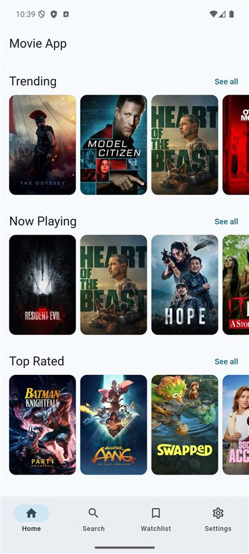
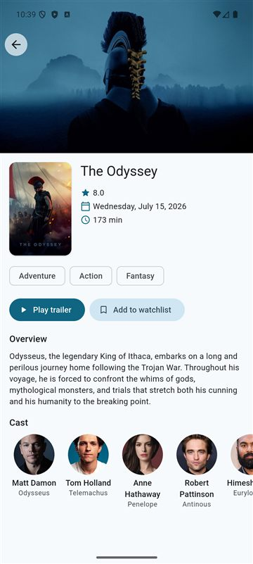
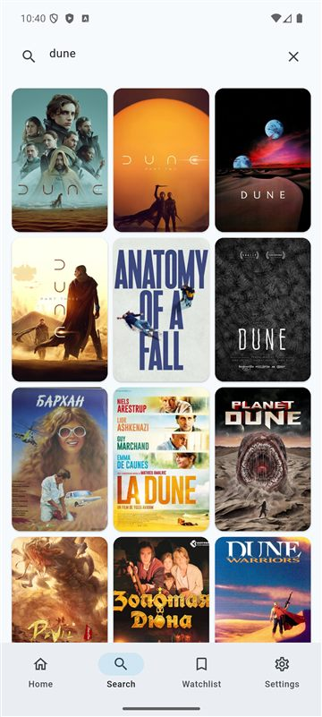
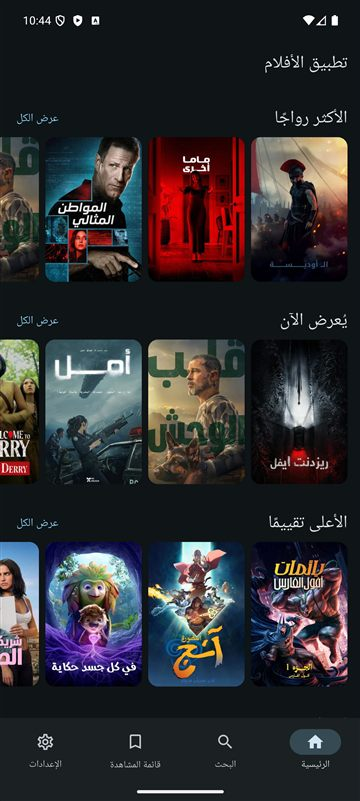
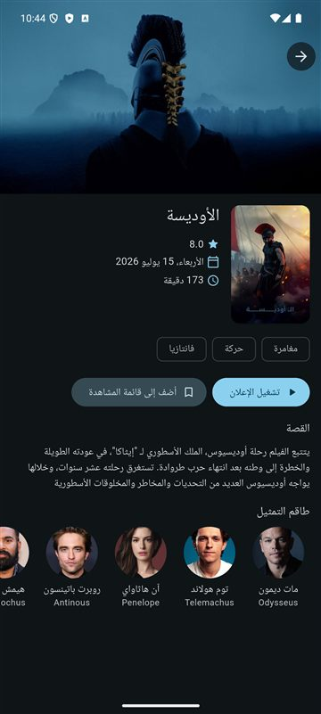
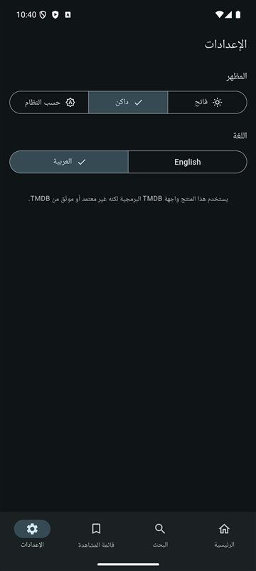
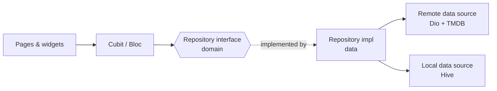

# Movie App (Flutter)

[](https://github.com/lamees987mo-netizen/movie-app-flutter/actions/workflows/ci.yml)


A movie browser built on the [TMDB](https://www.themoviedb.org/) API.
Clean Architecture, Bloc/Cubit, an offline cache, and full Arabic (RTL) and
English support, with 232 tests.

| Home | Details | Search |
|---|---|---|
|  |  |  |

| Home (Arabic, dark) | Details (Arabic, dark) | Settings |
|---|---|---|
|  |  |  |

## Features

- **Home**: Trending, Now Playing, Top Rated and Upcoming, with skeleton
  loading and pull-to-refresh. Each section loads and fails on its own.
- **See all**: an endless grid per section that loads the next page as you
  scroll.
- **Movie details**: Hero animation for the poster, rating, runtime, genres,
  cast and a "Play trailer" button that opens YouTube. All loaded in one
  request.
- **Search**: results as you type, with a 400 ms debounce.
- **Watchlist**: saved on the device with Hive, so it works offline.
- **Offline mode**: the first page of every Home section is cached per
  language. Without internet, Home shows the cached movies and a
  "You're offline" bar, then refreshes by itself when the connection is back.
- **Settings**: light, dark or system theme, and Arabic or English. Movie
  titles, overviews and posters also switch language.

## Tech stack

| Area | Choice |
|---|---|
| State management | `flutter_bloc`: Cubits, plus one Bloc for search |
| Networking | `dio` with auth, language and error interceptors |
| Dependency injection | `get_it` |
| Navigation | `go_router` (bottom navigation shell with one stack per tab) |
| Local storage | `hive_ce` |
| Models | `json_serializable`, `equatable`, Dart 3 `sealed` classes |
| Localization | `gen-l10n` (ARB files), RTL layout |
| Testing | `flutter_test`, `bloc_test`, `mocktail`, `integration_test` |
| Linting | `very_good_analysis` |
| CI | GitHub Actions |

## Architecture

Three layers per feature. Presentation never imports the data layer.



```
lib/
├── core/        # DI, network (Dio + interceptors), router, theme, errors, shared widgets
├── features/
│   ├── movies/     # data / domain / presentation: home, see all, details
│   ├── search/     # Bloc with debounce
│   ├── watchlist/  # Hive repository + cubits
│   └── settings/   # theme + language Cubit
└── l10n/        # en / ar ARB files (+ generated code)
```

- **Data sources throw** `AppException`s. **Repositories never throw**: they
  return `Result<T>`, either `Success(value)` or `Err(failure)`, where
  `Failure` is a sealed class. A `switch` over it must handle every case,
  so the compiler catches a forgotten error type.
- **Cubits call repositories directly.** A use case exists only where there
  is logic to hold (`GetMovieDetails`), not as a pass-through for every call.

## Why I chose…

- **Cubit everywhere, but a Bloc for search.** Most screens are "load, then
  show". Search reacts to a stream of keystrokes, which is what Bloc's event
  transformers are for.
- **Debounce without an extra package.** The search handler uses
  `restartable()` and starts with `await Future.delayed(400ms)`. Each new
  keystroke cancels the previous handler while it waits, so only the last
  query reaches the API, and a slower, older response is never shown. (The
  HTTP request itself is not aborted; its result is ignored.)
- **Guarding against stale responses.** Quickly switching Arabic → English
  starts two refreshes. Each cubit numbers its requests and ignores answers
  from older ones, so a late Arabic answer can't overwrite the English one.
- **Language in one place.** A Dio interceptor adds `language=ar|en-US` to
  every request, read from the settings at request time. It also adds
  `include_video_language`, because TMDB returns almost no Arabic trailers.
  Without it, the Arabic app had no "Play trailer" button.
- **Offline cache keyed by category and language** (`trending_ar`), stored as
  a JSON string. After an app restart, Hive returns nested maps as
  `Map<dynamic, dynamic>`; a string avoids casting problems. The cache is only
  used for network errors. A server error is shown as an error, so it can't
  be hidden behind old data.
- **No `freezed`.** Dart 3 `sealed` classes and `equatable` cover states and
  failures with less generated code.
- **Generated code is committed.** A fresh clone builds without running
  `build_runner`, and CI fails if the generated code is out of date.

## Testing

- **232 unit and widget tests**, with **90% line coverage**. Every file in
  `lib/` is counted, even ones with no tests; only generated files and
  `main.dart` are excluded.
- Cubits and the Bloc are tested with `bloc_test`, including race conditions
  such as late responses and pagination while refreshing.
- Repositories and Hive storage are tested against a real Hive box in a
  temporary folder.
- **One integration test** runs the whole app on a device with a fake
  repository: open a movie, save it, and find it in the watchlist. It needs
  no internet and no token.

```bash
flutter test --coverage                  # unit + widget tests
flutter test integration_test -d <id>    # on an emulator or phone
```

## Getting started

1. Get a free TMDB **API Read Access Token**: create an account, then go to
   [Settings → API](https://www.themoviedb.org/settings/api).
2. Clone the repo and add your token:
   ```bash
   git clone https://github.com/lamees987mo-netizen/movie-app-flutter.git
   cd movie-app-flutter
   cp env.example.json env.json   # then paste your token into env.json
   flutter pub get
   flutter run --dart-define-from-file=env.json
   ```
   `env.json` is git-ignored, so the token is never committed.

Requires Flutter 3.44 (Dart 3.12).

### About the token and the APK

The token is passed with `--dart-define`, so it is compiled into the app.
Anyone who downloads an APK could extract it. That's why this repo
publishes **no APK**: build it yourself with your own token. A production
app would call TMDB through a small backend instead.

## Credits

This product uses the TMDB API but is not endorsed or certified by TMDB.
Movie data and images are provided by [The Movie Database (TMDB)](https://www.themoviedb.org/).

---

Built by **Lamees Elsaka** · [GitHub](https://github.com/lamees987mo-netizen)
